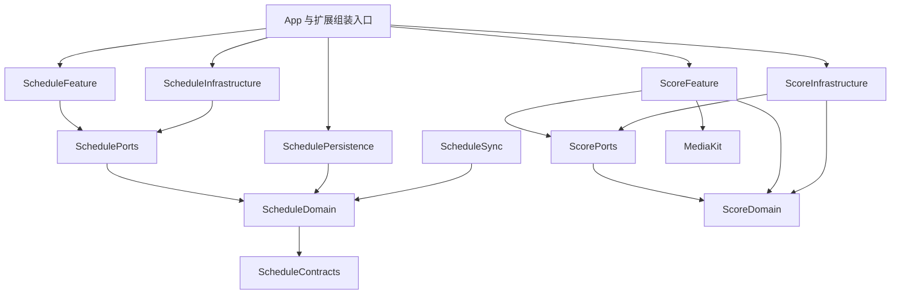

# 架构与数据边界

## 模块职责

`Package.swift` 定义本地模块及直接依赖，是编译边界的维护入口。模块源码位于 `Modules/<模块>/Sources/`。

| 模块 | 职责 |
| --- | --- |
| `StorageCore` | 文件服务、文件元数据与路径解析、账号分区和 Codable 存储 |
| `TransportCore` | HTTP 传输、会话构造、重定向、网络状态、网络缓存维护、请求观察与取消语义 |
| `CommunityTransport` | 社区请求、账号代际、凭据快照、恢复合并与业务错误映射 |
| `ClientCore` | 学校认证协议、CAS 解析、会话状态与密码学适配契约 |
| `ScheduleContracts` | 外部快照、Watch 传输、时间线与展示状态契约 |
| `ScheduleSharedStore` | App Group 快照文件读写与迁移 |
| `ScheduleDomain` | 日程模型、场景快照、同步载荷和纯业务规则 |
| `SchedulePorts` | 学校服务协议、同步错误与平台操作协议 |
| `SchedulePersistence` | 注入式日程文件仓库、迁移、保护写入与版本校验 |
| `ScheduleInfrastructure` | 学校课表、DDL、空教室与认证服务实现 |
| `ScheduleFeature` | 日程仓库、场景状态、编辑、分享与页面 |
| `CommunityCore` | 社区模型与通用列表状态 |
| `CommunityPersistence` | 注入式共享草稿与消息已读持久化、迁移和账号变更流 |
| `CommunityUI` | 公共社区展示、跨场景目标工厂和图片编辑组件 |
| `DesignSystemKit`、`MediaKit` | 公共视觉组件、图片展示与缓存 |
| `ScoreDomain` | 成绩行、课程摘要、刷新 / 排序 / 汇总规则 |
| `ScorePorts` | 成绩与可信成绩单服务、学校认证 challenge、缓存及筛选存储与同步合同 |
| `ScoreInfrastructure` | 注入式成绩 / 可信成绩单服务、成绩缓存与账号筛选存储 |
| `ScoreFeature`、`MapFeature` | 成绩与校园地图场景 |
| `GalleryFeature`、`CourseFeature`、`PaperFeature`、`MineFeature` | 话廊、课程、文章与个人主页场景 |

依赖按基础能力、领域协议、业务场景、App 组装的职责组织。Feature 间导航通过 App 壳层提供的目标工厂连接。共享能力归所属模块，各模块声明实际使用的直接依赖。社区内容偏好变化时失效已加载的分栏、推荐预取与搜索结果，详情评论沿偏好身份重载；解码失败保留业务提示及底层字段错误。



图中展示主要业务依赖；网络、存储、学校认证和设计系统的直接依赖以 `Package.swift` 为准。验证流程见 [构建与测试](TESTING.md)。

## App 组装与状态流

App 入口位于 `BIT101-iOS/BIT101_iOSApp.swift`。`Login/` 承接凭据恢复和登录；`Shell/` 组装网络、账号仓库、业务依赖和全局路由；`Settings/` 承接设备偏好与用户操作。

```text
App 入口 → 登录恢复 → AppAccountLifecycle → 各场景状态与页面
                    ↘ 网络、存储、云同步、系统能力适配
```

- 外部展示适配器显式接收账号会话、登录判断、Watch 激活、Widget 导出、后台刷新和 Live Activity 操作；生产能力由 App 入口组装，异步恢复后核对账号及取消归属。
- `ScheduleCourseSyncCoordinator` 持有课程同步、学期加载、短信等待和提交阶段，统一管理请求任务及账号重置取消。ViewModel 消费其展示状态，学期选择、课程编辑与持久化由日程场景承接。
- `AppAccountLifecycle` 显式接收日程实例、偏好同步、社区依赖、成绩服务、日程变更与课程加载能力、媒体、清理操作及外部展示协调器；设置、更新检查器、提示协调器与账号仓库由 App 组装层显式提供，通知权限检查和提示队列同时绑定完整账号代际，启动提醒、关于页和壳层共用所选提示实例；更新检查消费所选设置的自动查询开关，生命周期和偏好同步消费同一实例。生产日程、凭据后端、账号事件源和外部展示实例由 App 入口选择。
- 账号弹窗携带账号及会话代际，生命周期在账号变化时取消所属队列和活动弹窗。鸣谢确认使用创建时捕获的设置会话，登录后的壳层按账号重建。
- 网络诊断由设置场景组装，接收所选社区会话、HTTP 传输、网络路径、学校能力与成绩单服务。诊断任务同时捕获社区及学校身份；账号或代际变化时收敛当前任务。实例归属合同执行生产诊断路径并核对每个注入能力的调用。
- `AppAccountSession` 选择凭据后端、学校 Cookie 清理能力和账号分区。`LoginStorage` 发布携带账号及代际的 typed 变更流；生命周期与社区请求消费同一凭据来源，事件归属在消费边界核对。Keychain 实现归 `KeychainLoginCredentials`，测试使用内存后端。
- 学号、密码和 Cookie 合为单条 Keychain 会话记录并原子保存。退出状态独立持久保存，凭据清理失败时保持已退出；本地偏好清理保留该状态和安装标记。凭据读取遇到系统临时保护时，在前台与保护数据可用事件中重试，并通过账号事件恢复页面状态。旧分项凭据在成功迁移后清理。
- 本地数据清理共用 `AppLocalDataComposition` 的实际操作绑定。自动化宿主选择隔离凭据、偏好与文件服务，共享快照沿同一文件服务保存，WebKit 选择进程内存数据仓库；清理后的凭据、共享快照、报告、媒体文件、URL 缓存与 Cookie 沿原生资源状态验收。
- 设置、成绩、筛选和消息仓库通过 typed 保存 publisher 发布账号会话；偏好同步协调器在构造时持有独立订阅。
- `AppSettingsStore` 注入偏好存储与账号会话提供器。`AppAccountStores` 持有业务仓库及会话提供器，生产默认实例在 App 组装入口选择。
- ViewModel 通过场景化服务协议接收业务能力；View 绑定状态和操作，平台适配器负责系统副作用。个人主页响应核对请求的用户 ID，沿同一启动路径读取注入服务，UI 宿主在 App 组装入口选择受控传输。个人主页、用户资料和所属列表的首次加载失败通过页面恢复状态呈现，已加载内容的刷新失败保留内容并呈现提示。
- Profile、Poster、Paper、Settings 导航能力按消费者拆分，`AppCommunityDestinations` 负责跨 Feature 工厂。个人主页删帖通过 `MineDependencies` 注入，业务动作归所属场景。
- 页面入口显式接收状态、服务、MediaEnvironment 和所消费的导航能力，并向内部视图安装同一实例。空教室分栏在日程缓存恢复完成后启动查询，节次筛选更新沿恢复后的账号快照执行；当前空闲结果按分钟重算，跨日记录显示刷新提示。导航目的地携带构造依赖，课程学分来源通过闭包注入。
- `ScheduleRepository` 持有完整日程缓存与写权限，初始读取完成后开放编辑，读取异常时沿可用内存状态继续展示和操作。课程、DDL、教室、展示偏好和同步元数据各自拥有独立状态；场景整体提交所属状态，跨场景查询消费只读上下文。保存任务按实例排队，捕获账号、代际与修订；同步操作等待持久化完成，再发布成功状态。保存失败保留编辑并呈现错误。手动课程名称、教师和组合地点共用外部快照的 4096 字节字段上限；Widget 与 Watch 快照写入错误通过公共错误提示呈现。 云端基线在保存队列期间变化时，仓库相对已读取版本三方合并用户状态并重试保存；独立编辑共同保留，相同内容的分歧通过页面选择解决。合并规则与跨设备用户状态归 `ScheduleDomain`，同步协调和 CloudKit 适配继续消费该领域合同。
- 新增课程和日程共用设计系统周次多选列表，默认选中课表正在显示的周次。自定义日程以一条记录保存首个日期和其余日期，各次课表条目、提醒及系统日历事件拥有独立身份，编辑和删除应用于整组记录。课表容器按顶部切换栏的公共间隙布局，底部沿系统 Tab 栏顶部保留同一设计系统间隙。
- 日程云端载荷使用版本 3，读取版本 2 后升级载荷；多周日程日期与手动调课规则共同进入生产同步协调器。学校源记录 ID 的变化沿稳定来源字段匹配，接收和重新获取学校课表共用规则协调。
- DDL 同步分别读取课程中心和乐学，首次读取自动发现乐学订阅地址；每个来源独立更新，成功来源与已缓存的其它来源共同展示，完成状态按来源标识保留。 日期与来源同行展示，共用课程名的正文字号；列表预览按有效文本行排列课程名和描述。
- 账号资料修改任务归注入的账号依赖持有，页面重入共享修改锁；离开页面取消任务，上传和资料绑定沿取消状态及账号身份推进。举报响应丢失采用创建结果待确认语义，当前弹层暂停再次提交。

- 日程变更流按来源、账号和代际筛选；保存期间的重载在队列完成后按本机修订核对归属。继续编辑的字段保留在仓库中。
- 本地日程保存核对快照与磁盘的已确认云端基线；基线变化时保留磁盘新数据和内存修改，呈现保存失败。提醒按开始时间分组，以线性批量计算保留重叠日程、相同开始时间及每个未来时间边界，通知日期向上取整到秒；后台调度在异步读取后核对账号代际与取消状态。
- `AppScheduleCacheEffects` 接收账号会话与代际、云同步、提醒和系统日历能力，生产资源在 App 入口组装。日程仓库与页面消费同一适配器；保存后的云推送及提醒授权返回时核对账号归属。Widget、Watch 与 Live Activity 由应用生命周期的平台适配器协调。自定义日程实例的身份绑定记录与日期，系统日历按日程组替换及删除，缩减周次时同时回收组内事件。系统日历导入消费课程快照和学期，独立 actor 串行维护事件展开、EventKit 查询、批量写入与事务回滚；权限返回后通过主线程核对账号，再执行事务。

- `ScheduleSync` 通过账号代际、按会话加载、比较保存、传输和冲突呈现协调用户状态；CloudKit 容器及 system fields 适配归 App。App 生命周期在启动、前台恢复和学校账号切换后触发课表云端拉取，所属任务随生命周期结束或账号变化取消；偏好 KVS 与课表 CloudKit 各自沿所属同步开关执行。提醒上下文同样注入账号与缓存；壳层消费生命周期实例持有的缓存变更、账号及提醒查询，设置页消费同一组装入口选择的云同步展示。
- 日程缓存的磁盘读写与云端准入共用课程、考试、个人日程的身份和日期时间校验；本机损坏数据按块重置并覆盖缓存，有效块继续供页面使用。课程按学期及所属课表核对唯一身份，手动规则、DDL 和分享课表按各自集合核对唯一身份；规则投影后的课程沿同一身份合同准入。手动 DDL 需要有效标题，标题与详情各采用 4096 UTF-8 字节预算，云端手动记录沿手动来源准入，学校正文由本机学校同步持有。日程云同步保存已确认用户状态作为本机三方合并基线。独立 DDL、自定义日程、分享课表和手动课程规则按稳定 ID 合并，学校日程完成状态按 ID 合并；相对基线的删除继续传播，同一记录或列表顺序的并发分歧进入冲突选择。合并保留既有顺序，同时新增的记录按 ID 追加，页内课表选择按记录身份绑定。同步协调器通过单一阶段维护推送与拉取的互斥关系。
- 媒体校验和静态 / GIF 解码消费注入字节；系统照片通过 App 组装的照片读取能力，在提供者文件有效期内按 32 MiB 预算读取；媒体环境接收该能力并供各编辑入口消费，读取在并发执行器响应取消；建议附件逐张读取、压缩，预览保留压缩结果，草稿图片按设计系统尺寸解码缩略图；图片和头像下载沿统一的 32 MiB 原始字节预算执行，缓存读取在加载前核对文件尺寸，图片、头像与预览默认消费同一文件服务和容量协调器，每次写盘完成后执行共享容量检查；独立缓存文件服务沿显式注入配置各自的容量检查。图片 Smoke 共用传输预算与 48 MiB 静态位图解码预算。Quick Look 通过显式系统文件服务准备 URL。ActivityKit 属性归 ScheduleActivityContracts，领域复用的 ScheduleContracts 提供纯共享快照及时间线。Domain 与 Contracts 的直接及传递依赖共同保持纯业务边界，资源实现由 Ports、Infrastructure 与组装层承接。
- `MediaKit` 的预览协调器持有 Quick Look 控制器；来源视图拆除时取消资源准备并关闭预览，关闭回调按控制器身份匹配当前请求。Quick Look 预览项通过同步锁读写 URL，支持系统后台读取与主线程资源升级。低清补齐和原图升级共享当前页刷新，初始资源准备失败沿设计系统呈现反馈。图片显示预算释放唤醒等待预算的视图；网络失败沿显式图片重试代际重新请求。GIF 元数据扫描、共同时间片计算和像素解码共同响应取消。

- 社区根页及详情页通过依赖、媒体和资源身份绑定内部场景生命周期，依赖替换会重建状态与任务。
- 课程、帖子与文章详情共用交互任务持有者，页面退出取消所属排序、分页、重试及写入任务。帖子与文章详情分别维护正文和评论请求代际；评论排序保留正文加载结果；回复视图沿可见区域构建，点赞沿命中分支更新评论树；生产读取与 Smoke 共用评论所属对象、回复树正数及唯一 ID 校验，指定用户帖子核对作者归属。文章列表与搜索持有刷新任务，替换请求及页面退出取消所属任务；失败及取消恢复已加载分页和同一快照的作者预览元数据。并发文章预览共用一次凭据校验，正文缓存按校验完成后的凭据快照复用，并以全部文本字段沿正文展示字节预算准入。作者预览记录成功与失败结果，刷新重试沿所属请求代际更新；正文保留唯一外部块身份，重复、空与缺失身份按块位置稳定生成，并避开外部身份占用；资源上限分支共享同一身份规则。正文块和列表项共用总渲染节点预算，纯文本直接构造富文本，超额正文沿原文入口阅读。话廊发帖后的最新流刷新替换旧请求结果，失败恢复刷新前分页快照。编辑器通过明确关闭入口处理草稿，评论发送期间锁定输入与关闭。课程顶层评价沿后端合同提交 0.5 至 5 星评分，回复承接文本。建议页的图片载入与压缩串行接收批次，页面退出取消所属任务，附件追加沿当前剩余容量执行。建议提交前将请求身份、上下文与时间保存到所属草稿，附件复用草稿图片资产；页面重开后同一内容沿完整载荷重试，编辑后的内容生成新身份。提交记录损坏时保留草稿并提示显式清理。
- 列表行的分页任务身份绑定已加载状态与源游标，刷新相同对象后重新接入分页；消息恢复完成发布独立任务代际，使渐进首屏在恢复后继续加载历史。
- 推荐分页的共享请求携带独立身份；失败清理核对请求归属，刷新后的页面复用当前代际的缓存。源页标识随过滤结果传递，重复检查在过滤前执行。分页状态共用增量 ID 索引，追加仅访问新页；整体替换重建索引。系统内存压力回收话廊闲置分栏，当前分栏保留内容和阅读游标。
- 课程、文章、话廊列表 / 推荐 / 机器人 / 评论与社区验收共用源页进度合同：连续四个非空页缺少新标识时结束当前批次，保留已加载内容与重试位置。验收查找和评论采集按服务端标识去重，清理失败继续保留恢复记录。
- 话廊页面退出时取消交互请求并结束推荐预取；预取链在等待网络时保持弱持有。帖子深链发布结果与错误前核对当前链接和任务取消状态。
- `ScoreInfrastructure` 的服务、缓存和筛选存储分别由 `ScoreService`、`ScoreCacheStore` 和 `ScoreFilterPreferenceStore` 维护。`ScoreFeature` 消费 `ScoreCaching` 与 `ScoreFilterPreferencesStoring` 及各实例的 typed 账号变更流；缓存和筛选实现归 `ScoreInfrastructure`，认证、账号事件及存储合同归 `ScorePorts`，刷新判断、排序与汇总归 `ScoreDomain`。成绩领域通过 Foundation 模型保持独立编译边界。本地保存流供偏好同步订阅，页面变更流按账号筛选。持久化完成后按捕获的账号记录同步版本及待上传状态，界面账号切换沿各自版本继续协调。筛选偏好端口提供读取受阻状态与保存结果，成绩页呈现受阻提示并保留原始损坏快照。
- 成绩查询依次读取简略与详细字段，接口先验证业务状态、必要表头和行宽；缓存恢复核对账号及展示代际，空快照同步清空列表。账号切换恢复各自排序。学期候选合并成绩与课表缓存，完整待出分学期参与选择。未出分估算按所选学期核对完整课表缓存，课程身份优先匹配编号，缺号记录按名称匹配；课程性质筛选管理已出分成绩的展示与统计。
- 首次筛选保存等待学期与课程性质候选完成初始化；此前选择的排序随首次完整快照保存。已有筛选快照保留用户明确清空的选择，损坏快照继续通过保存结果呈现受阻状态。
- 可信成绩单页面通过 `MediaKit` 呈现本页图片预览，预览状态和挂载点随成绩单页面生命周期管理。首次申请与手动重试共享页面任务，退出页面取消在途操作。客户端资源预算为 64 页、32 MiB 图片传输和 48 MiB 全部页面位图；结果页读取同样受传输预算约束。生产会话按流读取并在超限时取消下载，后台 ImageIO 解码按页分配位图预算，完成后发布整组页面。
- 发帖编辑、校验、草稿恢复、上传重试和提交归 `GalleryComposerViewModel`；View 承接输入、确认和导航。页面拆除时取消在途操作，迟到结果核对账号代际与场景代际；编辑已有帖子沿所属帖子提交，并原样保留服务端插件载荷；新帖草稿保持独立归属。举报分类采用服务端结果，空列表暂停提交，加载失败呈现重试；弹层状态模型持有加载及提交任务，页面退出取消任务并过滤迟到完成。
- 话廊列表、搜索和评论使用 `GalleryPageBatch` 传递源页游标与可见内容，过滤后的空页继续推进源分页。推荐追加沿源游标跳过连续重复或过滤空页，取得新增内容或到达源列表末尾后结束；课程、文章及文章搜索的页码列表同样推进完整重复页；话廊、消息历史页要求正值、严格降序标识且位于请求游标之前；消息及三个详情页的评论刷新失败保留已有内容与分页位置，评论排序随已加载快照恢复。评论点赞按 ID 和写入修订合并在途读取，刷新与分页保留读取开始后的成功点赞；公开主页关注沿同一修订规则合并资料刷新。文章删除沿请求进行中状态限制重复提交。社区验收清理读取原始评论，以恢复被展示设置过滤的创建标识。 粉丝、关注和公开主页帖子及详情评论沿同一连续重复页预算推进，普通刷新失败保留既有分页快照。
- 草稿读取按实际文件读取结果区分缺失与失败；账号归属明确的历史草稿沿原账号迁移，共享路径中归属缺失的历史字节原样保留。成功提交后的草稿清理返回结果，清理失败保留页面并提供清理重试，重试沿已确认的提交结果执行。
- 共享草稿模型、图片限制和按消费者划分的存储端口归 `CommunityCore`；原子存储与迁移归 `CommunityPersistence`，图片编辑与压缩组件归 `CommunityUI`。存储注入图片准备闭包，Foundation 路径在包级宿主运行。图片尺寸限制由存储边界校验，账号路径、元数据和资产版本保持统一契约。
- 话廊消费 `GalleryComposerDraftStoring` 与 `GalleryMessageReadStoring`，建议提交页消费 `DeveloperSuggestionDraftStoring`。消息页面订阅所选存储实例的 typed 变更流，本地保存流供偏好同步订阅。
- 设置入口安装所选设置、日程及媒体实例；账号服务和凭据通过同一社区会话传递。媒体清理按资源 ownership 删除自有目录，活动预览文件在最后一个使用者释放时删除；通用临时文件与其他缓存由各自使用者管理。清理服务接收文件后端、自有缓存目录和完整操作能力，生产 Keychain、偏好域、URLCache 与 WebKit 绑定归 App 工厂。App 生命周期持有同一清理服务，根容器在清理期间展示进度并暂停交互；成绩和草稿共用持久化访问登记，清理先暂停新访问并等待已接收操作结束，再删除文件；完成后恢复访问并切到登录页，新会话数据沿完成后的状态建立。登录模型在请求入口维护单次提交状态，启动校验和显式登录的完成结果核对会话修订。社区会话通过独立凭据流传递同账号 Cookie 续签，内置网页在可信站点更新 localStorage 并在值变化后刷新。登录界面订阅所选服务的会话变更，凭据撤销后回到登录页；登录检查与资料更新共享请求状态，操作入口在任务调度前发布忙碌状态；编辑弹层在提交期间暂停输入、再次提交和关闭。
- `ScheduleCacheTimestamp` 的单调版本和云端恢复规则归领域层；App 保存队列通过公共协调器验证排队后的账号代际及取消状态。日程磁盘日期采用 Foundation 默认的完整精度编码，解码支持既有 ISO 8601 日期文本，比较保存沿精确版本执行。

视觉令牌、公共组件和页面约束见 [设计系统](DESIGN_SYSTEM.md)。

偏好同步协调器在 MainActor 维护账号、版本、订阅与展示状态；`PreferenceCloudPayloadCodec` 在并发执行器完成 JSON 编解码、压缩和加解密。Keychain 适配准备不可变密钥操作，后台载荷返回后沿账号、同步代际、本地修订和首次合并读取的云端原始值核对归属；远端值变化时重新执行领域合并。连续编辑加入同一协调队列，切换账号与关闭同步撤销所属任务。Apple 账号变更沿 KVS 与 CloudKit 通知同步更新代际，后台载荷返回时核对学校账号及 Apple 账号完整归属，再重载全部同步域。

偏好同步采用版本化云端记录，读取既有记录后迁移到当前记录空间。迁移额度按新旧记录共存计算，确认替换值写入本机 KVS 后回收旧键；迁移空间不足时在既有键继续同步当前格式，空间满足时完成记录空间迁移。本地合并基线与云端读取均区分缺值、格式错误和版本超前；损坏及版本超前记录保持原值并显示同步问题，基线初始化、编辑记录和重载沿相同读取契约执行。设置与筛选按字段版本合并，扩展字段随载荷往返保留；消息已读记录取并集，成绩沿快照版本同步。成绩载荷读取前后核对域版本，同一本机规范目录或同一引用型文件后端的成绩存储实例共用磁盘 actor；其他值类型后端沿注入实例持有独立仓库；云端应用在磁盘仓库内比较读取时的完整快照；本机并发保存进入下一次协调。学校 JSON 解码和课表归一化结束后核对完整账号代际。学校认证请求与短信挑战携带账号代际，Cookie 安装和学校会话恢复核对请求归属。成绩刷新阶段明确区分认证、等待验证、简略查询、详细查询和空闲；短信等待的提交与取消清理携带所属请求身份。网页话廊通过 WebKit 的独立网站存储同步当前凭据，更新后重载页面；迟到注入回调核对当前凭据及代际，注入失败进入重试页面并记录错误域与编号。

消息已读历史每个分类保留最近 1024 个 ID，本地未读候选按完整未读窗口保存；消息页通过游标读取该窗口，候选与本机已有记录合并，历史分页继续按需加载。确认前保存新消息边界，确认后通过安全历史分页恢复期间到达的消息；中断后沿持久边界继续恢复。恢复扫描沿原始页尾判断边界，到达边界后一次保存候选快照，再清理持久恢复标记。共享游标状态按消息 ID 去重，从原始页尾维护游标，游标停滞或重访已读页时结束分页；跨设备已读合并取较新的保留边界。消息仓库按账号与偏好中的文件修订标识复用解析结果，其他存储实例写入后重新读取。页面查询复用失败读取状态，显式刷新与存储操作继续尝试恢复；等价的已读操作保留文件修订与云同步事件。未读摘要增长时重新读取一次首屏，再按该首屏读取之前的数量确定候选窗口；摘要持续增长时保留已读状态与服务端未读数，暂停本次确认并提示重新刷新；历史保留边界同时过滤本机候选与云合并结果。

网页话廊使用独立的内存 WebKit 数据容器。页面通过 `GalleryWebCredentials` 消费 Cookie 读取及变化通知；App 入口适配社区会话。凭据注入同时核对页面的 HTTPS 来源与脚本执行时的来源，外部链接通过系统打开能力交接。连接建立、导航及网页进程失败展示重新加载入口。帖子、搜索、机器人与评论的筛选服务每批最多扫描五个源页，推荐首屏沿相同预算推进。原始标识与源游标共同保留，空批提供继续查询入口。

话廊、课程与文章评论共同消费回复树的先序展开结果及正文展示预算，原始正文供编辑和复制使用。未读摘要解码校验非负数量与总量容量；角标汇总沿安全求和处理本机与服务端状态。摘要失败保留恢复原因及诊断，相关列表暂停已读写入，重试成功后继续处理消息。

## 网络边界

`HTTPClient` 负责 HTTP 响应和状态码；`CommunityAPIClient` 负责社区请求与业务映射；各 Service 描述 endpoint 和场景数据组合。带特殊字符的业务标识通过 `pathComponent` 作为单个路径段编码，资源路径与业务标识分别组装。传输通过 `HTTPTransport` 注入，请求准入与结果记录通过 `HTTPClientObserving` 注入。网络诊断绑定启动时的社区及学校身份，各阶段核对账号代际，设置页面退出时取消所属任务。观察器为每个请求创建所属上下文，账号代际在发送前捕获；诊断写入、最近记录与学校外链查询核对所属账号，清理全部本地数据同步清理诊断队列。

`Shell/AppNetworkClients.swift` 组装连接池、网络提示、教学中心会话与诊断。`Login/CommunitySessionSupport.swift` 提供身份快照和按会话实例合并的登录恢复动作；用户主动诊断归 `Shell/NetworkDiagnosisRunner.swift`。`ScoreInfrastructure` 的生产端点和连接池在 App 扩展构造器中选择。

HTTP 请求证据沿传输事实与业务投影分工：`TransportCore` 记录方法、脱敏端点、完整 URL 摘要和响应状态，通过作用域观察端口交付原始请求及响应；App 的 `NetworkSmokeRequestEvidence` 解析业务参数、分页游标和课程列表，保存脱敏后的 smoke 合同。URL 参数保留完整名称集合，公开业务值沿白名单保存，其余值使用脱敏占位；路由合同核对完整参数形状。JSON 请求及表单中的 JSON 保留每个对象的原始成员键，重复键与转义后相同的键进入请求歧义验收，原请求及重定向请求共同核对。紧急更新配置保存响应内容摘要、启用状态与 notice ID。发布脚本以完整公告配置的规范化 SHA-256 摘要生成身份，相同配置复用身份，标题、正文、受影响 Build 或更新地址变化形成独立身份。传输与业务投影分别沿所属测试宿主验证。

网络 Smoke 的 `NetworkSmokeProbe` 集中声明固定机器标识与中文显示标签。执行库存、短信认证证据和请求合同使用机器标识，报告通过 `probeLabels` 提供显示文案。范围库存沿 Swift 声明与工厂方法提取，显示标签独立调整。

维护脚本按单向依赖组织：策略和输入登记提供基础数据，Swift 索引提供语法、类型、常量求值与控制流事实，编译条件读取 Package 和工程的语言及部署版本，来源模块负责摘要和报告事务，库存、性能、人工观察及工作流模块消费这些能力。Python 静态审计覆盖直接导入与函数内导入的循环依赖。网络请求合同回归集中在来源测试模块，验证入口测试负责组装与发布门禁。网络能力与 UI 渲染规则共用控制流分析，视觉合同筛除不可达分支、助手调用及容器表达式中的隐藏内容。生产网络能力发现与 Smoke 调用图复用存储闭包绑定，连接构造实参、闭包属性及后续调用；局部别名、成员初始化和局部遮蔽遵循同一解析事实。闭包数组的初始化元素、追加元素与循环调用沿 AST 绑定接入共用调用图，传参后继续核对消费方法中的实际执行路径。可调用对象的显式与隐式 `callAsFunction` 复用类型解析和调用图。SwiftSyntax 调用事实统一可选调用名称，并保留 selector 参数及绑定目标；生产网络能力发现沿外部 selector 注册追踪私有回调。UI 手势验收从 AST 构造提取动作集合，组合手势分别核对各项证据，回调中的文本及临时构造沿独立范围处理。显式 `self` 调用沿声明类型及模块解析，生命周期调用图同时沿父类型与协议实现追踪；云同步许可绑定模块归属，同名的其他业务入口继续接受学校请求约束。

底层资源权限沿模块和完整名义声明绑定。话廊网页适配及协调器持有 WebKit 视图资源，HTTP 传输沿共享传输边界选择。平台类型扩展与项目名义声明分别登记；同步资源组装沿已解析构造器追踪实际副作用，保存的回调沿实际消费位置传播。属性赋值保留接收者身份，其他对象的同名字段沿其所属对象解析；隐式属性赋值及局部初始化保留各自 AST 身份，可选解包继续沿所属资源的实际类型解析。成员读取与实际调用分别保留，嵌套类型的 `Self` 返回值沿声明所属类型连接后续调用。媒体内部下载及显示入口、学校会话恢复适配按完整方法签名登记基础能力；公开媒体探针与登录服务承担对应网络验收。传输、请求发送、连接监控、文件访问、偏好选择及共享网络缓存各有明确持有者；声明可以在所属模块内移动，其他声明通过端口访问资源。检测回归覆盖扩展、同文件多类型、嵌套声明与跨模块同名声明。Foundation socket stream 沿类型身份进入网络资源边界及能力库存，内存流沿所属内存能力使用。公共网络能力库存覆盖函数、访问器、构造器和闭包属性，闭包声明与构造器赋值按词法作用域区分业务属性和局部变量。URLSession 由所属传输实例持有；最后一个客户端释放传输后完成在途任务并关闭会话，Cookie 容器切换沿相同生命周期回收旧会话。平台资源与项目同名类型按声明身份区分，显式 Foundation 访问、系统类型扩展及继承继续接受资源门禁。


远程图片视图统一沿 `MediaKit` 加载；资源门禁识别 SwiftUI `AsyncImage` 的直接构造、限定类型及元类型引用，并按声明身份区分项目同名类型。

成绩查询的错误呈现核对当前页面内容；简略阶段已取得的成绩在详细请求失败后继续显示，缓存保留该阶段结果与更新时间，后续刷新补齐详细字段。

`URLSessionTransport` 在 TransportCore 内构造 Foundation 会话并维护共享网络缓存；App 的连接池选择配置、Cookie 容器、重定向策略及连接等待和超时参数，向业务层提供 `HTTPTransport`。连接池将整体资源期限限制在 90 秒以内，沿业务配置保留更短的期限；持续响应同样受整体期限约束。登录客户端接收两种重定向策略的 `HTTPClient`；学校日程服务显式接收传输，生产与测试沿同一注入入口执行。

`NetworkPathState` 在 TransportCore 内维护可观察的连接快照。App 将同一实例注入话廊、文章及诊断展示，页面依据连接恢复执行所属场景的重试。测试宿主可注入固定快照，路径状态按实例隔离。

网络警告按路径和冷却窗口协调用户确认，确认等待沿提示生命周期执行，网络诊断计时从传输开始采集。请求取消结束所属等待，公共提示继续服务其他等待请求。错误展示队列共用一个重试任务，取消等待同时清理所属排队项，账号重置释放重试与提示。Watch 本机清理在原有共享快照文件保存精简版本边界，重启后继续拒绝旧传输，新快照沿版本前进恢复课表。

`HTTPFormEncoding` 统一学校 CAS、教学中心与乐学请求的表单字段编码，维护特殊字符、Unicode、字段顺序和重复字段语义。`ErrorChain` 统一取消、学校网络错误、日程提示与地图定位的底层错误遍历，按错误对象身份处理循环引用；各业务层维护所属错误分类。

`ScheduleServiceFactory` 为教学中心传输注入同一请求观察器，诊断在网络错误映射前记录原始原因。统一认证轮询的 `status: failed` 响应按业务失败记录；HTTP 状态码与服务端原因同时保留，提交反馈时按所选模式脱敏。认证字段在两种模式下均强制遮盖，覆盖 JSON 结构型值、凭据响应头、学校 HTML 任意标签中的认证字段和截断响应；URL 路径、查询名称及值、片段按解码内容遮盖当前凭据，嵌套 URL 沿相同规则处理。响应头名称与结构化字段共用敏感名称规则；截断 JSON 整体遮盖，完整 JSON 保留普通业务字段。反馈页面持有创建时的账号代际，账号更新后沿重新打开页面的流程提交。提交捕获账号、凭据及载荷快照，后台执行脱敏与大小裁剪，返回时核对账号归属并继续发送。建议和错误报告页面各自持有一次提交的 UUID 与完整载荷，失败重试复用首次内容，编辑内容建立新提交，成功后释放载荷；回执编号与请求编号一致时发布成功。Worker 在报告保留期内按编号和内容摘要归并受理，复用原记录与投递任务。

| 会话 | 边界 |
| --- | --- |
| `community` | 社区场景共用 Cookie、URLCache 与连接池 |
| `scoreAuthentication` | 普通成绩与可信成绩单共用 bit-login 传输，各自维护业务 challenge |
| `sensitiveDownloads` | ephemeral 配置下载可信成绩单图片，图片由页面 ViewModel 在内存持有 |
| 学校 CAS | 按业务需要分开管理手动重定向与 HTTPS 升级重定向会话 |
| 教学中心 | 使用独立 HTTPS delegate 和可失效的认证状态 |

- 学校会话的 Cookie 容器与传输实现配套注入。成绩生产组装与冷会话 Smoke 共用认证传输工厂，Smoke 使用独立 Cookie 状态与生产连接等待、超时及缓存策略。普通成绩使用 `jwb` challenge，可信成绩单使用 `jwb_cjd` challenge。
- 社区认证失败按 `CommunityRetryPolicy` 进入一次会话恢复重试；明确的凭据拒绝进入退出状态。请求发送、恢复、重放和解码完成时核对账号及登录代际，切号产生取消结果。学校认证与有副作用的请求按业务条件处理重试。
- 取消、超时、证书错误和业务失败保持各自语义。请求在准入、传输和响应处理边界检查取消；错误正文通过 `@concurrent` 解析，解析预算为 16 KiB、展示预算为 512 字符；结构化错误字段和简短纯文本承接提示，HTML 及未知结构沿 HTTP 状态码呈现。响应观察器按请求记录一次结果。
- JSON 解码、成绩解析、日程响应映射和话廊去重使用 `@concurrent`，沿用调用任务的取消状态、优先级和任务局部值；跨隔离域模型满足 `Sendable`。考试与教室记录映射由对应响应类型承接，网络服务组织请求与认证流程；文件保存由串行队列或 actor 承接。消息、草稿与成绩的磁盘 actor 使用 `StorageFileExecutor`，各仓库的独立串行队列承接同步文件操作，保持 Swift 协作线程池可用。
- 日志记录必要状态与错误分类，凭据、课表正文和学生信息保持在业务数据边界内。

课程中心 DDL 通过分页 `POST /api/my-courses` 获取全部课程，逐课读取 `GET /api/courses/{id}/activities`，并发上限为 4。会话过期后复用学校认证恢复、CAS 跳转和公共短信验证能力。作业以提交次数、迟交次数或批阅字段识别，截止时间优先采用 `end_time`，随后采用 `visible_end_at`；无时区时间按北京时间解析，带时区时间保留实际时刻。

课程中心与乐学事件分别使用 `eclass` 和 `lexue` 来源。来源完整读取后替换对应缓存；部分失败保留该来源数据并呈现部分更新提示。学校事件按稳定 ID 长期保留用户修改过的完成状态及已有完成历史，自动同步的默认未完成事件沿当前快照保存；重新出现的旧课程恢复原完成状态，显式撤销完成同样参与跨设备同步。手动事件独立保存，详情显示中文来源。列表按滞留天数筛选过期事件，空态说明筛选数量与当前窗口。

课程中心整次快照共用响应预算，体积上限沿 HTTP 结构化响应上限与四路并发计算，耗时沿 URLRequest 默认超时计算；截止计时与读取任务共同执行，超时后取消在途请求，每次请求使用剩余耗时。课程分页沿首屏总页数读取，后续元数据变化进入来源失败。JSON 解码、活动转换、去重与排序在后台执行，返回后核对学校账号身份。乐学 ICS 按独立 VEVENT 解析，参数引号中的分隔符遵循 [RFC 5545](https://www.rfc-editor.org/rfc/rfc5545.html#section-3.2)。包含重复规则、日期例外、例外实例或同 UID 冲突事件的来源进入失败并保留已有缓存。

## 存储与账号隔离

`AppStorageSession` 统一生成账号级偏好键和安全目录名，访客使用固定分区。任务创建时捕获账号归属；切号后根据代际处理迟到结果。

设置快照与成绩筛选共用 `AccountScopedCodableStore` 的编码、读写和账号键迁移。读取区分缺值、有效值与损坏值；损坏值保留源数据并暂停写入及所属云同步域，保存成功后发布变更。仓库显式接收已有游客键后缀；设置沿用 `__default__`，其余消费者沿用 `guest`。设置实例与静态读取共用游客映射，账号隔离前的共享快照迁移归设置业务层。

消息已读状态使用账号目录下的 `message-read-snapshot.json`，以受保护的原子文件写入完成本地提交，随后确认服务端未读窗口。旧偏好快照沿 `AccountScopedCodableStore` 读取，首次成功写盘后完成迁移；偏好中的版本标识驱动实例间缓存失效。已读历史按分类保留 1024 项，显式未读候选独立保存；确认中的新消息边界进入同一文件，后续打开页面继续恢复。读取、保护或写入失败保留已提交内容，并暂停确认及所属云同步域。

本地文件读取按字节访问。日程快照采用 16 MiB 读写预算，生产文件读取核对元数据并按预算读取；超限保持原文件和写入门禁。课程记录在 Codable 解码边界验证排课字段，原始课程、历史 / 分享快照和调课规则共用相同约束。用户持久目录参与系统备份，启动时在后台恢复既有 Library、Documents 和 Application Support 的备份标记；系统 Caches、临时目录和可重建共享展示承担缓存内容。写入先准备所属目录的备份资格，再提交文件内容；元数据准备失败保留已提交内容，原子写入与文件保护由调用方的写入选项控制。目录统计、批量删除和遗留预览清理在后台执行，主线程发布清理状态。

成绩磁盘快照保存格式版本和附加字段，读改写保留当前版本中的扩展数据，格式超出支持范围时保留源文件并暂停写入及该同步域。简略行替换完整行时清除详细更新时间。日程磁盘快照与云端载荷在恢复前校验节次 ID 唯一性。

| 数据 | 保存位置与生命周期 |
| --- | --- |
| 学号、密码、`fake-cookie` | Keychain；安装标记位于 UserDefaults |
| 学校 Cookie | 对应会话的 Cookie 容器 |
| challenge、access token、短信状态 | 业务会话内存；退出、切号、过期或明确失效时清除 |
| 主题、旋转等设备偏好 | 应用级 UserDefaults |
| 账号设置、成绩筛选、消息已读状态 | 账号级偏好或业务仓库 |
| 日程、成绩、发帖草稿 | 账号隔离的 Application Support 文件 |
| 可重建图片与头像 | Caches，按容量和 LRU 策略回收 |
| 外部课表展示 | App Group 中的精简快照 |

- 文件保存采用原子替换及首次解锁后的数据保护。草稿图片以独立 JPEG 文件保存，单张上限 1 MiB，存储上限为九张；当前元数据上限为 1 MiB，历史内联图片载荷按同一图片预算计入 Base64 开销。恢复前核对元数据及图片文件大小，图片读取沿单张字节上限执行，恢复时校验附件数量与历史图片字节。草稿读取结果区分缺失、完整快照、读取损坏和格式版本差异；保存与提交清理沿完整源数据核对写权限，恢复状态保留元数据及图片。当前账号路径优先于历史路径，支持的历史载荷在成功原子写入后迁移源文件；明确放弃草稿时清理所属源路径。
- 文件字节、目录、元数据和符号链接解析统一由 `AppFileService` 承接；媒体缓存的 LRU 路径归一化消费所选文件后端。App 更新检查、偏好云同步和系统日历从 `AppFileDirectories.defaults` 选择生产偏好，测试沿显式注入入口选择独立实例。
- `SchedulePersistenceStore` 注入文件服务、根目录和用户状态比较器；App 的缓存适配器维护生产账号选择与通知，云同步基线在串行写入中合并。
- 日程磁盘快照使用整体 `schemaVersion`，当前格式按业务区域编码；历史平面格式由集中迁移入口解码，版本校验与完整解码决定写入准入。各学期学校课程、考试和首周日期统一存入 `ScheduleCourseData.schedulesByTerm`，当前展示由所选学期、手动首周日期和调课规则派生。磁盘恢复保留完整调课规则，展示按本机学校快照筛选；成功接收学校快照后再协调规则，跨设备学校缓存差异期间持续保留云端调课。完整日程滚动保留两个学期，归档学期保留原始课程供成绩匹配。分享导入追加 `sharedSchedules` 中的只读记录，导入字段为学期、首周、时间表与课程，当前账号日程保持原值。
- 日程和成绩缓存读取失败时保留源文件，暂停对应写入和同步，呈现恢复状态；扩展使用当前账号的空快照。
- 正常覆盖升级保留本地缓存、分享课表和偏好。日程磁盘格式变化递增整体版本，并在集中入口维护迁移；迁移为新增字段提供默认值，格式校验失败保留完整源文件。其他 Codable 模型沿所属领域维护默认值及字段迁移。
- 设置和成绩筛选快照采用格式版本，历史快照沿缺省值迁移。账号存储保存已知字段时保留扩展字段，清空已知可选字段时移除对应键；未来格式和异常版本保留原始数据并暂停保存。设置的共享旧快照经过同一版本校验后迁入账号分区。
- 退出登录清理会话凭据，账号缓存和草稿保留供下次登录恢复。设置中的“删除所有文稿与数据”清理文稿、账号存储、草稿、验收记录及 App Group 内容，远端 iCloud 数据继续保留。文稿 Inbox 按内容清理，系统组件存储由所属清理接口处理。
- 学校认证、成绩和教学中心共享账号所属的内存 Cookie 容器。退出或切换账号时替换容器，传输池在下次请求选择对应连接；迟到响应继续写入原容器。教学中心会话经过显式身份认证后复用，Cookie 的存在沿所属身份判断。
- 重装后的首次启动依据安装标记清理旧 Keychain 凭据。登录恢复暂时受阻时保留待确认会话，远端明确返回凭据失效时清理登录凭据。

## iCloud 同步

两条同步链路分别维护开关、数据范围和冲突处理：

- **课表 CloudKit**：`ScheduleCloudSyncManager` 使用私有数据库，按账号同步手动调课、放假规则、个人日程、分享课表、手动 DDL、学校 DDL 完成状态和日程偏好。学校课程、考试、DDL 正文和查询缓存保存在本机。
- **实验性偏好 KVS**：`ExperimentalPreferenceCloudSync` 同步设置、成绩筛选、成绩缓存与消息已读状态。开关保存在当前设备并按账号隔离，默认关闭；设置与成绩筛选按字段记录版本，独立字段的离线编辑在重连时合并；同字段按版本选择，同版本分歧按规范编码排序收敛。消息已读记录按分类取并集，候选列表由本机服务端响应维护。成绩缓存按域时间选择完整快照，采用 LZFSE 压缩、账号绑定的 AES-GCM 加密和配额检查；独立密钥通过 iCloud 钥匙串同步。钥匙串载荷尚待抵达时保留云端密文与本机成绩，设置页呈现待同步原因。历史明文载荷读取成功后迁移为密文。字段版本与本机载荷按账号持久保存；历史同步载荷按其域时间初始化字段版本。
- 偏好同步的待处理域和任务引用由当前批次维护；账号切换后的旧批次在恢复执行时核对取消状态。
- 已启用的偏好同步在启动和回到前台时重新协调本机与云端记录，补做变更通知和钥匙串载荷延迟后的恢复；实时变更通知按当前账号和领域匹配两个受支持的记录版本。

CloudKit 使用带版本的精简载荷，本地记录保留服务器基线、已确认的用户状态和待上传状态；本机用户编辑依据待上传状态提交，学校缓存更新时间持续独立于云端用户状态选择。首次两端独立编辑通过冲突选择建立共同基线，学校刷新后的本机缓存接收云端用户状态并保留学校数据。并发编辑相对基线进行三方合并。个人日程、手动 DDL、分享课表与调课规则按稳定 ID 合并，完成状态按事件 ID 合并，独立偏好按字段合并；校区与所属教学楼作为一组选择维护。同一记录的编辑分歧或删除与编辑冲突交给版本选择。选择时重新核对远端身份及格式，验证失败呈现失败状态并释放提示锁，恢复后的同一冲突继续允许选择。历史载荷通过已有迁移入口合并，版本兼容性决定同步准入。损坏的成绩缓存暂停该域的 KVS 同步。日程云载荷遵循单条 CloudKit 普通字段容量契约，UTF-8 正文预算为 1 MB 扣除 1 KiB 元数据空间；超限时保留本机待上传内容，并呈现缩减分享课表或历史日程的操作提示。学校 DDL 完成状态在成功同步的来源中记录消失时间，持续保留一年后参与三方合并回收；来源失败期间保持状态，跨设备并发记录消失时间时采用最早时间。日程同步身份同时携带学校登录与系统 iCloud 账号代际；App 沿 CloudKit 账号通知同步更新代际，云端读写及冲突选择在应用前核对完整归属与任务取消状态；替换同步任务后，迟到读取和写入结果停止后续本地应用及冲突提示，已提交云端写入沿下一次同步核对。弹窗关闭及账号归属失效时释放对应冲突快照，后续同步重新读取双方状态。课表同步状态由协调器按账号代际发布，设置页呈现同步中、待同步、成功、账号不可用、版本冲突与失败状态。

## Widget、Watch 与 Live Activity

`ScheduleReminderPlanner` 维护提醒候选、展示窗口和刷新边界的纯规则；`ScheduleReminderNotifications` 承接系统通知授权、排期与清理，Live Activity 管理器协调活动和任务生命周期。静态属性和动态状态沿 ActivityKit 的 4 KiB 总编码预算约束，长展示文本保留完整字符并显示省略号，日程源数据保持完整。本地创建沿 App 前台执行，边界任务沿进程执行机会重算，后台刷新时间交给系统调度；已排期的系统通知承接进程挂起期间的提醒。扩展沿原生有界倒计时和系统过期状态展示到点结果。平台语义见 [ActivityKit](https://developer.apple.com/documentation/activitykit/displaying-live-data-with-live-activities) 与 [后台刷新时间](https://developer.apple.com/documentation/backgroundtasks/bgtaskrequest/earliestbegindate)。

主 App 持有完整日程，导出 `ScheduleExternalSnapshot` 供外部展示消费：

```text
日程仓库 → 快照导出 → App Group → Widget / Live Activity
                   ↘ WatchConnectivity → Watch 本地镜像 → Watch App / Smart Stack
```

- App Group：`group.BIT101-dev.BIT101-iOS.shared`；快照路径：`Widgets/schedule-widget-snapshot.json`。
- 快照使用稳定的账号摘要表达归属；账号切换后的导出按 generation 串行协调。
- DDL 小组件沿同一快照读取未完成事项摘要与过期保留天数，独立于课程学期配置。桌面小、中、大尺寸和锁屏文字布局复用设计系统；截止、保留窗口结束及跨日由时间线切换，点击打开 DDL 分页。完成、删除与账号变化沿已有导出及刷新链路更新。
- `ScheduleContracts` 提供共享编码、状态解析和时间线规划；`ScheduleSharedStore` 注入文件服务、容器地址和通知中心。App、Widget、Watch App 与 Watch Widget 在各自入口选择 App Group 容器，并显式传入快照解析器。
- 日程日历统一使用 `ScheduleSharedDateCodec.calendar`；课表表头与日期调整文案使用 `ScheduleDateCodec.formatCompactDate`，Live Activity 时间使用共享时分格式。学期、缓存日期和系统日历展开沿同一公历及时区计算。
- `ScheduleExternalContentState` 区分同步、登录、快照有效性与课程状态；时间线一次推导学期 occurrence，各条目复用排序结果并按展示上限取值。`ScheduleTimelineRefreshPlanner` 规划课程开始、展示截止、结束和跨日刷新，重叠课程结束后保留仍在上课的末节课程。
- Watch 负责请求、落地和展示镜像；Live Activity 单独管理提醒生命周期。模型调整同步关注 App、iOS Widget、Watch App 和 Watch Widget。
- WatchConnectivity 的回复和错误回调显式使用 `@Sendable`，快照落地和业务完成回调转到 `MainActor`；Watch 状态模型的注入端口声明相同隔离契约。
- 共享快照携带主端单调版本，接收端核对版本顺序，保留较新的账号与退出状态；时间字段继续承接旧载荷。Watch 同步区分请求入队与快照落地，请求和状态回调按当前代际处理。
- 同账号缓存恢复沿用已发布的完整快照，读取完成后发布有效变化，相同内容沿共享快照重发 Watch applicationContext；账号和登录状态切换先重置共享展示身份，再读取所属缓存。
- Watch 清理结果传递到状态模型；失败时保留课表并呈现重试提示，共享存储成功清理后发布变更通知。
- 媒体缓存按等待者合并和取消下载，清理动作先终止在途写入，再清空文件；头像写入重建缓存目录。头像与话廊共享四个下载名额，同一来源和 URL 的在途请求按消费者合并。静态图片、头像和 GIF 按实际展示像素尺寸解码，活跃展示共用 96 MiB 位图预算并在离开界面时释放；静态解码缓存为 48 MiB，GIF 解码缓存为 24 MiB。静态图片、头像和 GIF 在解码前分配像素预算，通过 ImageIO 降采样生成显示位图；GIF 按源文件帧时长播放。
- 课前提醒后台刷新的启动回调通过主队列交付；过期回调使用 `@Sendable` 闭包取消刷新任务。

分享链接与自定义 Scheme 的契约见 [Cloudflare 资源](../Cloudflare/README.md)。构建、测试和固定 fixture 的维护入口见 [构建与测试](TESTING.md)。

## 服务边界门禁

`Scripts/check-module-boundaries.py` 从 SwiftPM 评估后的清单读取 target、源码路径、直接依赖和导出产品；模块集合与 `Modules/` 源码目录核对，层级方向和系统资源例外由检查器维护。清单中的多行、计算与条件表达式沿 SwiftPM 执行语义解析。编译配置与模块门禁共同消费 `validation_inputs` 中的清单读取和 target 解析，锁与缓存沿该输入入口共享。检查器扫描全部生产模块、App、Widget 和 Watch 源码，并按实现文件校验系统资源归属：文件操作归 `StorageCore/AppFileService.swift`，HTTP 发送归 `TransportCore/HTTPClient.swift`，会话及网络缓存维护归 `TransportCore/SecureURLTransport.swift`，系统网络监听归 `TransportCore/NetworkPathState.swift`。偏好默认实例归 App 存储组装入口。UI 场景控制连接限定在 App 的测试启动代码，通过条件编译启用。

门禁覆盖传输、文件、偏好及系统网络资源，按实际声明与调用链核对归属。App 适配器的职责约束继续传递给被调用的辅助函数，覆盖跨文件拆分及函数引用；诊断按源码位置去重。系统资源由所属模块实现，生产消费者通过注入入口调用。检查器的语法解析细节与正反例共同维护在源码及自测中；公共能力新增时同步维护所属模块、注入路径和门禁规则。

表单编码、底层错误遍历与日程页面日期格式同样接受门禁校验，消费者通过所属公共入口扩展规则。日程主页提供分钟级展示时钟，课表网格、线性时间轴、今日高亮、DDL 窗口及详情倒计时消费同一时间值；UIKit 承载的线性画布通过配置接收该时钟。

系统网络边界与业务能力发现共用 POSIX 网络入口登记，覆盖连接及 DNS 解析，并区分项目内同名函数与系统调用。CoreGraphics 的 URL 数据源及 PDF 文件构造沿文件服务归属验收，内存数据源沿原有解码路径使用。源码及资源目录中的 Git 忽略文件与 Scripts、Worker、Git 钩子中的可执行脚本共同接受输入门禁，系统目录元数据与已登记的 fixture 事务文件按固定例外处理。

系统日历入口在主线程捕获账号代际，串行执行域在事务入队与授权返回后核对归属，提交前检查任务取消状态。页面退出与账号重载取消所属操作，账号清理等待同步日历事务及批次写入完成。事件标记及本地批次使用稳定账号摘要，学期替换和清理按当前账号筛选。事件检索按 EventKit 的四年窗口分段覆盖完整范围，再按事件标识合并；批次回收、学期替换与标记删除沿同一查询入口执行。课程分享返回后按账号代际更新呈现。头像缓存读写与下载使用缓存代际，清理结束后迟到结果沿原代际失效。

日历导入批次在事件操作前读取，损坏的记录保留原始内容并报告读取失败。账号偏好和提示已读状态在保存成功后发布，保存受阻时保留当前展示状态。

网络路径保留检测中、已连接、等待连接及断开状态。等待连接的路径允许页面发起恢复请求，由实际请求结果确定连接能力。

学校课程学分沿有限数值解码，无法表示的可选学分沿既有缺值规则处理；领域课程及缓存验收持续校验学分的有限性。

成绩密文完成认证及载荷验证后，可恢复指向已缺失密钥的活动引用，并保留仍可读取的本地密钥。

偏好字段冲突沿设备提交的修改时间比较，设备系统时钟参与这一选择。共享日程快照在各设备由单一生产写队列提交，Widget 消费已提交的文件。

地图相机在接受定位动作时消费请求身份，校区与课程地点聚焦结束旧定位等待。偏好同步写回同时核对已知载荷、字段版本和扩展字段，保证跨客户端字段冲突收敛。

地图校区切换覆盖中关村、良乡和珠海；课程建筑定位使用中关村和良乡的人工校验坐标目录。教务建筑别名沿课表地点规范化规则匹配，缺少校区字段时由规范化后的建筑名称推断。目录范围以外的教室通过课程详情的地点提示展示匹配状态。

应用弹窗按提示身份核对动作和关闭回调，退场结束后推进队列。课表冲突弹窗携带同步账号及会话代际，入队时核对当前身份；按钮选择、系统关闭、账号切换统一完成一次回调并释放冲突提示状态。网络提示由多个请求共享，各请求独立取消等待；请求观察器在提示返回后核对发送账号。成绩与可信成绩单的认证、短信、轮询、Cookie、HTML 和图片阶段持续核对初始账号代际，challenge 携带创建身份。乐学、课程中心与原生短信认证持续传递整次操作的学校账号身份，手机号、验证码及表单上下文归同一代际。

话廊搜索首屏失败恢复已成功的内容、游标和查询快照。列表首屏刷新期间暂停后续分页，取消后释放所属分页状态；首次进入被取消时保留重入加载能力。话廊同类刷新及分页操作共用在途任务，下拉刷新等待所属请求结束；搜索页退出取消搜索及分页任务。推荐首屏沿源游标跳过过滤空页，读取至可见内容或源流末尾。课程、文章与话廊分页持有成功首屏对应的查询和排序快照，输入编辑及后续首屏失败沿用已有结果的分页条件。详情正文与评论通过结构化子任务并发请求，页面任务的取消传递到两条请求。详情读取核对成功点赞的版本，合并刷新期间提交的点赞状态；文章首屏加载期间单独保存并展示成功点赞。乐学日历要求完整组件结构及有效事件；损坏来源沿失败结果保留既有日程。订阅链接更新等待所属保存完成后发布成功。

Quick Look 会话登记正在使用的文件，图片与头像配额共同保留这些路径；远程预览文件的创建、复制、登记与回收沿同一状态锁执行，共享预览目录的环境显式接收同一 `MediaPreviewStorage`，生产环境的存储在 App 组装层持有，关闭预览后恢复配额回收。缓存命中和图片、头像写入在等待容量检查时登记文件所有权，完成交付、取消或清理时释放；图片文件创建与登记在同一锁内提交。容量扫描沿文件服务批量预取普通文件的大小及修改时间，并按规范目录生成文件路径；目录别名和符号链接沿共享文件服务合同验收。本地 UIImage 预览文件按会话登记，共享同图的预览在最后一个会话关闭时删除文件；预览环境清理遗留的本地预览缓存。远程图片准备返回前核对缓存代际。媒体清理同步释放静态与 GIF 解码缓存。Watch 清理边界采用单调时钟，清理前接收并排队的快照按原接收时间失效；清理后的镜像继续核对已接受版本，重新同步携带该版本边界请求主端推进。

文章正文解析预算为 256 KiB、256 个块及每块 16 KiB；规模超限或扩展格式保留原文阅读提示，混合正文保持块位置。正文使用 LazyVStack 按需构建视图。文章 HTML 导入沿主线程执行，输入保留内联文字格式与链接，资源标签与其他属性在导入前清理。文章编辑器同时校验原始正文结构与解析资源预算：预算内的纯段落正文支持原生文本修改，超限正文、图片、富文本和扩展块保留原始序列化内容并支持元数据编辑。提交状态机承接输入校验、服务调用与取消结果，页面持有提交任务并将完成回调绑定到页面生命周期。编辑请求携带详情载入时的更新时间作为服务端版本参数，并发编辑冲突沿业务错误返回；版本字段解析失败时保留草稿内容。

成绩旧缓存迁移沿整份快照验证；任一已存在字段损坏或类型异常时保留原字段并暂停同步与写入。消息未读摘要沿请求代次接收，分类列表成功加载后清零相应服务端摘要。详情刷新取消统一恢复可继续加载的分页状态。媒体加载身份包含资源地址、注入环境与重试代际；话廊刷新、网络恢复及回到前台触发失败图片重试，已加载图片继续显示。GIF 从 SwiftUI 接收系统减弱动态效果偏好，变化后沿同一资源缓存切换动画与静态帧。环境变化触发重新加载并隔离旧响应。

App Store 更新检查与网络 Smoke 共用请求构造、缓存刷新、应用标识、版本日期和更新地址的解析契约。发布版本门禁核对同一应用身份、记录数量、有效发布日期、商店链接与查询响应来源。自动提醒使用当前版本发布日期计算等待期。短信验收证据核对认证目的与所属学校探针；测试清单预处理复用 Swift 词法扫描识别编译指令。

CloudKit 冲突选择本机版本与三方合并沿 `cloudBaseline` 保存新基线及待上传状态；确认远端完整载荷后的 `cloud` 保存由磁盘仓库清理待上传标记。同步消费者回归与跨设备 Smoke 通过注入文件服务运行真实持久化规则。后台会话检查核对所验证的 Cookie 版本，续签后的凭据独立于旧响应。课程中心将已提供且格式异常的作业标识或截止日期视为来源失败，完整快照合并保留该来源的既有日程。

Watch 激活自动拉取沿启动请求代次调度，手动请求与清理操作拥有更新代次。成功接收快照发布独立通知，相同快照的后台交付完成当前刷新反馈；Widget 时间线沿实际快照变化刷新，Watch 清理成功后刷新共享时间线；App 清理共享快照时独立发布空课表，发布前核对账号和导出代际。动图和 Quick Look Coordinator 更新注入环境时取消旧准备、释放旧预览所有权并捕获新环境。发帖图片准备在场景独立 actor 串行执行，复用草稿尺寸与字节预算，预览与上传共享准备后的数据；状态机在异步准备完成后核对生命周期。

课程中心课程页逐条验证身份与名称后去重；重复课程身份核对名称，重复活动身份核对标题、截止时间与完成状态，字段分歧沿来源失败保留既有日程。ICS 解析核对已提供的时区标识并支持引号参数；未知时区沿完整快照失败处理。跨源重定向清理学校 challenge 认证头，认证信息保持原点归属。文件服务门禁复用 SwiftSyntax 识别推断构造与 POSIX 调用，覆盖 FileWrapper 的磁盘构造、读取、比较和写入，同时保留内存包装能力；区分本文件的业务方法。图片预算以输出像素为单位，编码倍率固定为 1。

固定 XCTest 结果包、诊断与截图的读写共用工作流锁；iCloud JSON 进度报告读取原子替换后的完整快照。反馈 Worker 分别维护正式报告与探针的日预算，并以来源摘要限制单个来源占用；列表索引保持平台元数据预算。反馈收件箱在工作线程内逐份落盘并提交成功内容，单份读取或 JSON 失败保留该键的重试资格，保留附件原始元数据及解码错误，完整报告进入处理记录，异常附件报告保留重试资格并传播部分失败。GitHub Issues 和 CI 列表拉取失败保留上次成功缓存；CI 日志失败同时保留错误及既有日志，汇总标明各来源的获取状态。

评论编辑弹层通过 SwiftUI 任务承接提交，编辑目标的身份确定内容生命周期，取消与关闭同步终止所属任务。创建请求在发送与响应边界核对任务状态，服务已确认的评论保留发送成功结果，后续刷新沿读取任务处理取消。社区创建响应丢失、无效响应和发送后取消使用明确的结果待确认错误，当前编辑流程保留内容并拦截再次提交，帖子与文章创建沿关闭编辑页后刷新已发布内容核对结果；评论沿重新进入详情页、刷新评论并核对结果恢复发送，待确认状态归原详情模型持有。点赞与关注的发送后不确定结果先沿详情或关系读取收敛，读取失败时暂停该对象的下一次切换，新的有效读取恢复操作。课程列表持有首屏刷新任务，搜索替换与页面退出取消所属请求。跨编辑会话及进程的单次创建保证需要后端提供幂等键与查询合同。边界检测器将省略返回类型解释为 Void，并结合显式类型与推断构造识别偏好实例来源。

课程周次范围为 -53 至 -1 和 1 至 53，周次选择与调休写入共用这一范围。日程日期和时间输入采用固定公历与北京时间。编辑、分享导入、系统日历导出与跨端日期计算共用排课字段约束，节次按一天的分钟容量约束并核对实际时间表，相邻节次允许共用时间端点，合法待排课程沿空坐标保留。学校同步和云端时间表应用在保存前核对实际课程节次；存在差异时保留已有课表并提示补齐时间表。学校课程以课程号和排课坐标生成记录身份，课程号缺失时沿领域层的名称与教师规则区分；名称缺失时使用课程号展示。课前提醒提前量统一约束为 1 至 60 分钟，展示偏好的修改、磁盘解码、云状态应用和提醒规划沿同一约束执行。分享码解压正文限制为 1 MiB，课程记录限制为 4096 条，编码与解码沿同一规模约束执行。

登录凭据在恢复和保存边界形成完整内存会话，账号、密码和 Cookie 沿同一快照读取。凭据暂时读取失败保留显式读取问题，恢复成功时发布账号代际，持久写入失败继续保留已发布会话。普通 HTTP JSON 和 HTML 响应采用 8 MiB 默认流式预算，图片和成绩单沿各自资源预算读取；可信成绩单报告和图片在读取后核对最终学校 HTTPS 来源、端口及资源路径。学期滚动归档保留手工课程规则，重新读取学校课表后继续应用用户编辑。共享展示先校验课程周次、星期、节次及时间结构，再区分课程结束与数据异常。

社区写入恢复记录采用显式格式版本，持久保存评论与父对象的对应关系；历史格式依据已有创建证据迁移，进程重启后的确认沿已知父对象列表执行。历史记录读取保留已保存的对象、评论及点赞状态，新增集合沿历史格式缺省为空；迁移原子保存成功后清理原偏好记录。当前格式核对全部恢复集合，未知格式和损坏记录保留原始数据。

社区线上写入及恢复事务由 `BIT101-iOS/Shared/Client/CommunityWriteSmoke.swift` 维护，恢复记录格式由 `CommunityWriteSmokeJournal.swift` 维护；网络 Smoke 模型保存范围、报告及协调端口；检测器的 Smoke 豁免同时绑定完整 App 类型身份、所属源码路径与专项编译条件。存储层提供生产仓库共同消费的文件能力及账号偏好快照，成绩、日程与草稿的文件格式及迁移由所属仓库维护。

社区正文展示预算为 64 KiB，列表预览为 1 KiB；原始正文继续用于编辑和分享。文章新建及正文重写沿渲染器的总字节、单块字节与块数预算验收。链接扫描在独立 actor 执行，缓存总成本为 8 MiB。社区日期格式器按主线程隔离复用。话廊分页在请求阶段积累新增页，释放读取快照后原地提交，历史列表与身份索引沿同一存储继续追加。

节次身份、时间格式、顺序和日界点校验归 `TimeSlot`，缓存、分享及设置共用；调整时间表前核对已保存课程的节次引用。Watch 请求携带本地已接受版本，手机回复前把当前快照推进至该版本之后并写入共享仓库，后续导出沿同一单调序列继续。

社区认证请求显式使用会话凭据，并跳过本地响应缓存；公共请求沿系统缓存策略复用连接池。共享网络池验收覆盖凭据切换、无效凭据拒绝和原账号恢复，宿主回归同时覆盖共享 Cookie、缓存与迟到响应的账号归属。Widget 与 Watch 共用快照写入 actor，在同一串行边界维护内容、账号和递增版本，读取回复与清理参与同一版本序列；发送端保留最高版本镜像，迟到回复继续发送当前镜像。

共享日程快照沿有界读取加载，传输与文件共用 1 MiB 字节预算、4096 门课程上限和字段预算；节次与周次集合沿日程领域约束控制规模。版本最大值在记录与请求边界视为异常，源记录保留到正常快照替换或显式清理。静态类型索引保存模块、导入关系和文件私有身份，继承、别名与函数返回类型沿声明所属范围解析。

社区 Feature 沿业务组织页面、状态、模型与所属 HTTP 适配，场景依赖按列表、详情、编辑和账号合同注入。公共模型与会话认证边界分别归 `CommunityCore` 与 `CommunityTransport`；跨 Feature 组合通过应用入口与已有合同完成。服务合同形成第二个独立消费者时收口到共享端口，服务实现形成独立复用时沿该合同迁入基础设施模块。

Domain 与 Infrastructure 的同层依赖限定在同一业务域；跨业务域能力经 Ports、Contracts 或 App 场景组装交接。Core 承接复用的基础与社区模型，明确的公共合同沿既有依赖图消费。模块审计同时核对层次方向与业务域方向。Swift 正则的边界沿 SwiftParser 的 RegexLiteralExprSyntax 采集，词法遮罩消费语法范围并保留源位置；分支条件、扩展分隔符、转义斜线与多字节前缀均沿回归样例验收。

话廊原始图片按资源 URL 合并下载和磁盘文件，静态与 GIF 解码按展示尺寸维护各自的位图。下载、缓存命中与静态及动画解码共用 ImageIO 完整状态校验，GIF 核对结束标记，PNG 沿块结构核对 IEND；头像数据在解码通过后落盘。损坏磁盘缓存沿重新下载恢复。文件服务提供原子替换的文件身份，磁盘有效性与解码缓存通过身份和尺寸识别命中；写入使用原子替换，内容替换更新身份，LRU 时间更新保留身份。共享文件服务合同覆盖本机及内存后端的身份行为。

按周课表在量化时间轴上将同日冲突的课程、考试和自定义日程并排展示。每个条目保留完整时间、来源身份和独立详情入口；首尾相接的条目复用列，冲突组结束后恢复完整列宽。课间、课前课后及量化跨度较短的考试和日程在网格下方保留独立详情入口，线性时间轴沿真实分钟展示。

媒体文件保护从缓存交付延续至解码或预览复制完成，容量清理保留正在读取的文件。GIF 解码缓存与活跃展示预算共同计入独立位图和播放帧引用数组。ICS 事件核对身份、起始时间、摘要及描述的单值属性和参数唯一性，歧义输入沿整份来源失败保留已有日程。

偏好云端的新旧格式记录共存时，设置和筛选按字段合并、消息已读取并集、成绩沿整份快照版本选择；合并后的正式记录写入本机 KVS 并提交系统传播后清理旧记录。成绩并发比较同时绑定两种格式的原始记录。云端密文读取复用所属钥匙串密钥并恢复缺失的本机活跃索引，跨设备 smoke 的隔离账号使用短字母数字标识，业务域及协调键共同核对 KVS 长度配额。

媒体环境统一消费系统内存压力通知，释放头像字节、头像位图、静态图与 GIF 的可重建内存缓存；活跃展示继续持有共享位图预算，磁盘文件保留。组合性能场景在满额活跃展示和各类解码缓存同时存在时执行四路最大传输，进程峰值内存沿实体设备性能基线验收。

上传媒体沿后端的内容寻址合同复用缓存：[ImageService.Save](https://github.com/BIT101-dev/BIT101-GO/blob/main/api/service/image.go) 以内容 MD5 与格式扩展名生成资源标识，同内容复用原记录；头像更新消费新的资源 URL，低清图沿该资源附加图片处理后缀。[后端配置示例](https://github.com/BIT101-dev/BIT101-GO/blob/main/config_example.yml) 的默认头像也采用内容标识文件名。保持资源内容与 URL 的对应关系属于媒体发布合同。

本地多页图片沿后台执行器编码、计算摘要和原子写入。Quick Look 先准备点击页，保留其余页的位置并逐张填充文件；预览会话状态与磁盘操作分别同步，打开与关闭即时更新状态，释放文件沿后台清理任务完成。写盘结束后核对会话归属，已关闭会话的文件沿共享租约登记清理。GIF 缓存与活跃展示共用按实际 CGImage 身份去重的位图成本，播放时长展开保留帧引用与独立位图的对应关系。

成绩缓存以 `ScoreCacheReadError` 传递读取失败，缺失值保留可选快照语义；页面与云同步协调器分别呈现恢复原因，成功读取后推进恢复标记。磁盘缓存及旧偏好迁移使用 16 MiB 编码预算，超限保存保留已提交快照。磁盘提交与保存、变更事件保持一致；写入期间取消沿已提交快照完成事件发布。待同步成绩的本地版本和已观察远端的 SHA-256 按账号保存在偏好中，重建协调器后继续选择对应版本；远端应用及上传完成后清理标记。

云端偏好清理沿日历设置的用户确认执行，范围分别为当前学校账号和其他学校账号，覆盖已有 v1、v2 同步域。清理关闭本机偏好同步并取消在途协调任务，本机设置、成绩缓存与已读记录继续保留；同步提交失败展示重试提示，用户再次开启开关后恢复协调。

日程仓库的三方合并与 JSON 等价比较沿后台并发函数执行，返回时核对账号、读取代际和本机修订。计算期间的本机编辑进入下一次合并，版本结果沿当前仓库状态提交。

日程持久化冲突期间，编辑入口、状态写入及保存队列共用可编辑合同，页面保留既有编辑并展示版本选择。选择版本并完成合并后恢复编辑，课程、DDL 与显示偏好沿同一权限状态更新。

学校周次解析保留单双周标记，周次位图与显示范围一致时保留位图中的间隔周。缓存恢复按学校描述修复单双周，关联调课规则同步更新来源快照，用户安排沿既有选择保留。DDL 列表为每条待办提供独立系统分组卡片，卡片采用单层背景，行边距沿系统默认值，内容间隔沿设计系统维护。课程分享预取由页面任务持有，选择变化及页面退出取消旧请求，迟到结果核对取消状态和账号归属。外部快照在编解码边界校验课程语义，异常数据保留既有有效快照；空课表及退出快照沿清空合同处理。乐学日历按取消状态移除事件，携带尚待支持的任务组件时进入来源失败，来源缓存沿部分同步合同保留。

共享课表读取区分文件缺失、快照损坏和存储不可读，展示层分别提示获取、重新同步和读取重试。存储读取及清理以实际文件操作和错误类型判定缺失，权限或元数据读取失败保持不可读状态，清理失败向调用方传递。有效快照可替换损坏记录，磁盘读取失败保留已有版本。Widget 与 Watch 组件从同一份快照预生成未来一天的课程开始、展示结束和午夜条目，系统沿时间线切换；快照变化继续触发重载。

日程首次恢复在读取及协调完成后标记完成，取消路径释放当前请求的加载状态，页面复入重新读取；迟到请求沿账号代际与请求编号核对归属。持久化在覆盖文件前核对主课表、共享课表及调课规则中的节次和课程坐标。整门调课先沿原始快照解析全部安排，再统一替换，合并或交换安排时保留各自周次；单节操作沿点击课块的来源、星期和节次选定目标，编辑周次沿原课程覆盖范围选择，节次清空后由保存校验提示。提醒读取保留文件缺失与不可读的区别；不可读期间保留现有通知、活动和后台排程，读取恢复后继续同步。课前通知替换保留原排期，逐条提交新请求并在全部受理后清理过期项；提交失败恢复已覆盖的原请求并清理新增项，恢复失败传递给调用方。账号变化时清理本次提交的请求，提醒刷新串行等待前次任务完成。系统通知端口提供实际受理数量与失败信息，系统授权和排期状态由通知适配器维护。

模块源码沿 SwiftPM 默认目录发现参与编译；原生源码库存与工程目标成员双向核对。网络能力登记覆盖媒体验收入口，缓存与系统展示适配沿具体方法合同限定。参数化模块测试将框架声明的实例身份与实际开始、结束记录完整核对。

社区点赞与评论创建的请求字段及编码合同集中在 CommunityTransport；课程、话廊与文章服务保留各自的接口及领域规则，沿共享请求合同适配现有后端。社区会话工厂将账号存储、传输客户端及续期客户端一并组装，首次请求与凭据恢复沿相同依赖归属执行。启动检查与社区客户端共享账号存储持有的续期协调器，并在明确的凭据拒绝后统一发布会话退出；恢复前后的账号及 Cookie 快照保护新会话。登录无参构造消费 App 账号资源，独立实例共同提供存储与两种重定向传输；成绩的 App 构造消费 App 账号资源，独立实例使用包级完整依赖构造器。

草稿显式清理通过存储端口返回删除结果，元数据删除失败时保留相应图片；编辑页沿结果决定关闭与重试。发帖恢复、保存、发布和丢弃共用互斥操作边界；恢复期间暂停表单及图片操作，图片准备完成后一次发布完整快照。声明加载失败显示错误并提供原位重试。图片配额在预览文件锁外枚举和排序，逐文件删除前沿当前租约在锁内核对，扫描期间新增的预览租约继续保留文件。

消息已读仓库在存储执行器中完成文件读取、编解码、压缩与索引构建，界面异步准备后复用内存索引。提交按文件服务及账号文件归属串行读取当前文件并合并，完成后回收队列记录；独立存储实例各自执行读取和编解码，提交后发布账号修订；读取和提交接入账号存储操作跟踪器，数据清理等待在途访问并暂停新访问，清理及账号生命周期变更显式失效内存快照；外部写入、云端合并和账号切换继续核对快照来源。消息首屏先展示，未读恢复保存标识并按系统请求超时及快照容量控制处理范围，正文沿滚动分页加载。

课程评价自动消歧同时检索课程号和名称，累计候选内存沿结构化响应预算约束，两路检索共同使用系统请求超时，计时任务在总期限到达时取消两路在途请求。达到处理范围时提示进入课程搜索，结果唯一性沿完整候选集合判断。

节次表使用从 1 开始的连续编号，行标签与课程布局共用该坐标契约。日程缓存按扁平格式与版本化结构集中读取，App 版本共用所属缓存格式的迁移入口。完全重复记录在读取时静默合并。完整读取失败时，学校课表、个人日程、手动规则、分享课表、DDL、空教室、展示偏好与同步元数据分别校验，损坏块使用默认值，并原位覆盖缓存。整份内容损坏或超过读取预算时重置为空缓存；保存失败时页面继续使用内存状态。已有课程尚未绑定所选学期时，按缓存更新时间选择有效学期并保存，离线启动直接展示课程。页面的浏览、编辑、学期选择和刷新沿正常流程运行。

缓存读取诊断记录文件保护、文件读取、大小限制、解码类型及已知字段路径；动态字典键统一遮盖。用户主动提交错误报告时附带当前账号的缓存诊断，沿反馈脱敏及大小预算处理。

个人主页与用户列表的手动读取由 SwiftUI 场景任务持有，替换请求与页面移除沿任务取消传递。关注和删除写入由所属请求任务持有状态机至结果确认。Watch 镜像传输失败后保留最新待发送数据及错误原因，在会话激活、可达性恢复和后续同步入口重试。

本地模块导入条件按显式依赖图求值；带版本参数的本地模块条件要求对应版本编译上下文，并在检测入口呈现诊断。系统框架条件由所选 SDK 和编译器求值。

SwiftSyntax 索引提供括号透明表达式和显式属性赋值事实。生命周期规则传播初始化器保存的回调，文件写入规则通过共享函数值与闭包调用事实传播效果，弃值检查沿实际表达式消费位置执行。

课表三方合并校验基线的根对象及记录、字典类型，损坏基线沿同步错误呈现；旧格式缺失的新增集合字段按空集合参与独立编辑合并。

Watch 课表刷新通过后台任务读取共享文件、解码及展开学期候选，MainActor 应用当前刷新代际的解析结果。后续刷新、清理本地数据和退到后台撤销所属读取任务；迟到结果沿代际核对结束应用。共享解析层同步检测任务取消，展示条数继续沿统一排序与当前课节规则截取。

App 的 Widget 导出沿共享快照 actor 读取磁盘，返回后核对账号与导出代际；快照组装消费内存课表，最终写入沿同一 actor 根据磁盘及已保留版本推进修订号。

Watch 快照接收、解码、版本比较、落盘与清理沿同一持久化 actor 串行执行，MainActor 发布接收结果与界面状态。接收时刻与已清理版本共同限制迟到数据，清理完成后的展示核对当前任务代际；回到前台重新请求手机快照。共享存储的同一实例及副本通过同步临界区完成版本比较与写入，跨进程展示继续由所属 App 的单一写入者维护。

KVS 本机写入回读与 `synchronize()` 成功代表系统已接受待传播内容。成绩待同步标记描述本机编辑等待交付 KVS 的状态，交付后由系统持久化与传播；设置页清理反馈使用“已提交”。另一设备观察到载荷和删除由双端 smoke 独立确认，清理报告沿 `requested` 与 `peer-observed` 区分证据范围。

成绩同步密钥按账号及独立密钥标识保留在 iCloud 钥匙串，密文携带所属标识。本机偏好重置后继续保留密钥，供云端记录及离线设备恢复解密；密钥退役以所属云端密文及设备引用的生命周期为边界。隔离验收空间在清理所属记录后清理其活动密钥。
